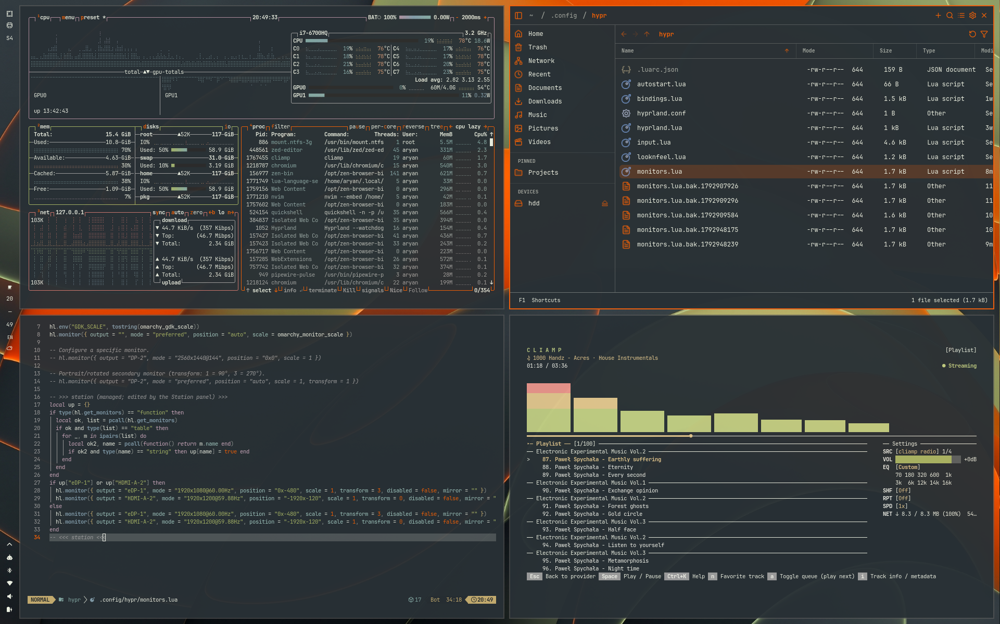

# Station


A dark Omarchy theme with charcoal surfaces, olive green, warm white, and
Station orange. It is designed for the
[Station multi-monitor plugin](https://github.com/Yakumy/Station) and was
created with Aether.

## Desktop preview



## Install

```sh
omarchy theme install https://github.com/Yakumy/omarchy-station-theme
```

To select it again:

```sh
omarchy theme set Station
```

## Palette

| Role | Color |
| --- | --- |
| Background | `#283035` |
| Dark background | `#272E33` |
| Deep background | `#20262A` |
| Lighter background | `#2C3433` |
| Foreground | `#ECF0E2` |
| Accent / orange | `#EE5F06` |
| Olive green | `#A6B465` |

`colors.toml` is the source of truth for the exported theme. This repository preserves
its Aether export without changing color values. Omarchy generates application
configs from this file. `icons.theme` selects Yaru-wartybrown when available.

## Backgrounds

Five backgrounds are included from the author's local theme export: four JPEGs
with Gemini-generated filenames and the Station banner PNG. Their original
filenames are retained. The JPEGs are 2528 × 1696 (three images) and 2752 × 1536
(one image); the banner is 1920 × 1080. These are not native-resolution backgrounds
for three horizontal 4K displays; that arrangement requires at least 11520 × 2160.

No separate wallpaper license or third-party attribution was present in the
original export. No additional asset license is asserted by this README.
